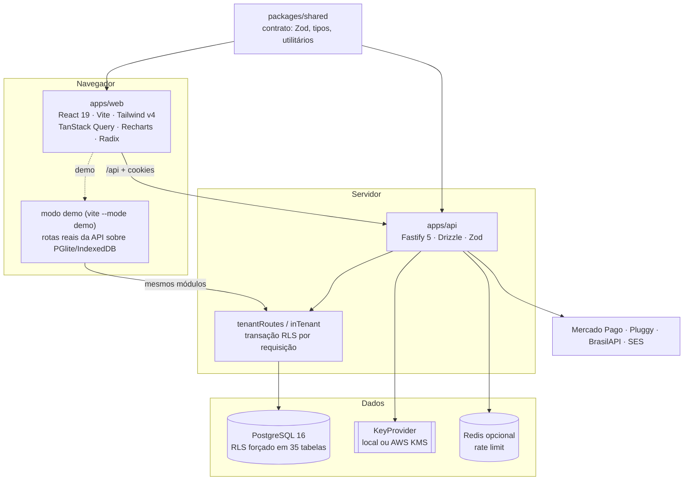

# Mapa do código — Efficio

> Gerado com o Cartographer. Última leitura: 22/10/2026 21:16 UTC. Tokens estimados (~4 caracteres
> por token; a rede bloqueou o download do tokenizer). Os snapshots gerados em `apps/api/drizzle/meta`
> (~180 mil tokens) não foram lidos.
>
> No momento do mapeamento estavam em andamento: 16 dos 22 widgets do dashboard (ainda "Em
> construção"), a aba "Inadimplência" dos relatórios, os cards da tela de Clientes e a geração de
> honorários (`/fee-charges`). Confira o `git log` antes de confiar nesses trechos.

## Visão geral

Sistema financeiro de um escritório de contabilidade (marca **Efficio**) construído sobre a base
**Effinance** (escopo `@effinance/*`, papéis `effinance_*`, cookies e chaves `effinance.*` mantidos
de propósito). Monorepo pnpm com três pacotes:



## Estrutura de pastas

```
sistema/
├── packages/shared/src/        contrato compartilhado (sem build; exporta o TS direto)
│   ├── constants.ts            enums + rótulos pt-BR (tipos, regimes, juros/multa, riscos…)
│   ├── schemas.ts              Zod de entrada (transações, clientes, relatórios, honorários…)
│   ├── types.ts                tipos de resposta (Transaction, DashboardResponse, Delinquency…)
│   ├── saas.ts                 espaços, papéis, planos, assinatura, auth/MFA, foto do perfil
│   ├── permissions.ts          chaves de permissão por pessoa, padrões por papel, ajustes (fase 3)
│   ├── contract-template.ts    modelo de contrato de fábrica (+ contract-watermark.ts, a marca d'água)
│   ├── integrations.ts         importação OFX/CSV e Open Finance
│   ├── regime-groups.ts        catálogo dos grupos padrão de recorrentes por regime tributário
│   └── utils/                  datas, dinheiro, documentos, fatura, recorrência, vigências,
│                               juros/multa (late-fees), score de inadimplência (delinquency),
│                               faixas de vencimento/ciclo da convenção (deadlines) e contrato
├── apps/api/
│   ├── drizzle/0000…0018*.sql  migrações (0004+ escritas à mão, reexecutáveis, rodam no PGlite)
│   ├── src/app.ts, server.ts   montagem do Fastify, hooks globais, árvore de rotas
│   ├── src/routes.ts           domainRoutes (tenantRoutes) e scopedRoutes (inTenant)
│   ├── src/setup.ts, env.ts    providers (e-mail, cobrança, Open Finance, CNPJ) e env validado
│   ├── src/db/                 schema.ts, client, migrate, retention, backfill, seed, demo-seed,
│   │                           bootstrap-owner (primeiro acesso: proprietário + link de senha)
│   ├── src/lib/                auth, tenant, crypto (cifra por campo, keyring), errors, sql, clock,
│   │                           permissions (chaves), scoped-context (módulos da fase 3), images
│   ├── src/modules/<domínio>/  routes.ts + service.ts por domínio (ver "Módulos da API")
│   └── test/                   integração com Postgres real (vitest, um arquivo por vez)
├── apps/web/src/
│   ├── app/                    router (browser; hash no demo) e providers
│   ├── components/ui|charts|layout   design system, gráficos e casca do app
│   ├── features/<domínio>/     api.ts (hooks) + pages/ + sheets/dialogs
│   ├── demo/                   servidor da API no navegador (PGlite) e testes do demo
│   ├── lib/                    cliente da API, query keys, tema, mês ativo, CSP, URLs seguras
│   └── styles/index.css        tokens claro/escuro e escala de texto compacta
├── docs/                       api.md, design-system.md, deploy-aws.md, este mapa
└── .claude/agents/             agentes de função (backend, frontend, design, 4 de segurança)
```

## Contrato compartilhado (`packages/shared`)

- **Regra do repositório:** altere o contrato primeiro; mudanças aditivas.
- **Dinheiro** é inteiro em centavos (`amountSchema` > 0; `signedAmountSchema` aceita negativo).
  Formatação só nas bordas (`formatBRL`, `formatCompactBRL`, `Money`, `MoneyInput`).
- **Datas** são strings `YYYY-MM-DD` com aritmética UTC (`utils/dates.ts`); meses `YYYY-MM`
  (`MonthKey`); semana começa no domingo. `todayISO()` usa o fuso local.
- **Clientes e fornecedores** são `contacts` com `kind`. Cliente exige CNPJ, regime e início de
  contrato; o anexo do Simples só existe no Simples Nacional.
- **Vigências de honorários** são anuais a partir do início do contrato (`utils/fees.ts`:
  `feePeriod`, `feePeriodIndexAt`; 29/02 cai em 28/02).
- **Fatura do cartão** é identificada pelo mês de vencimento; compra no dia do fechamento vai para a
  próxima (`utils/invoice.ts`).
- **Juros e multa** (`utils/late-fees.ts`): sugestão de 2% + 1% a.m. pro rata.
- **Score de inadimplência v2** (`utils/delinquency.ts`, spec `docs/projeto-melhorias-dashboards.md`
  §5.2): janela fixa de 12 meses, peso `0,5^(meses/6)`; probabilidade `(atrasos ponderados + 1)/(total
  ponderado + 5)`; pontualidade `1000×(1 − (Σ peso×gravidade + 1)/(total + 5))` com `lateSeverity`
  (0/0,25/0,5/0,75/1); −50 por recebível vencido em aberto, até −250; faixas ≥800 Baixo risco, ≥600
  Atenção, ≥400 Risco alto, <400 Crítico. **Score do cliente**
  (`utils/rework.ts`: `clientScore` = pontualidade − em aberto − retrabalho, 40 por retrabalho em 90
  dias e 10 por mais antigo em 12 meses, até 200). **Evolução da base** (`utils/evolution.ts`:
  `clientBaseEvolution`, `evolutionComparison`).
- **Geração de honorários** (em andamento): `generateFeesSchema`, `feeEmployeesSchema`,
  `FEE_CATEGORY` (Serviços Prestados / Honorários contábeis | Folha de pagamento) e os campos
  `feeCompetence`, `feeKind`, `feeOf`, `employees` em `Transaction`.
- **Tarefas**: seções "Tasks" de `constants.ts` (estados `todo…canceled`, prioridades, escopos,
  situações, grupos de prazo com "Fora da meta", 6 periodicidades, regra de dia não útil, situações da
  ocorrência, origem do responsável (`manual`/`default`; o responsável por cliente saiu na 0017), tipos de evento do histórico, tipos e limites de anexo, todos com
  rótulos pt-BR), `schemas.ts` e `types.ts` (`Task` com `kind`/`occurrence`/`flow`, `TaskDetail`,
  `TaskListResponse`, `TaskHomeResponse` com `obligations`, `RecurringTask`, `RecurringOccurrence`,
  `OccurrenceCell`, `AuditMatrixResponse`, `TaskFlow`, `FlowTemplate`, `TaskReportResponse`,
  `TaskCalendarResponse`, `TaskHistoryResponse`, `TaskAttachment`, `TaskNote`…) e `utils/tasks.ts`
  (atrasada, fora da meta, `dueBucketOf` pela data de trabalho, `dateInTimeZone`, **feriados
  nacionais** fixos e móveis pela Páscoa, dias úteis, `occurrencesInCompetence` com competência,
  referência, prazo legal e meta, `occurrenceSituationOf`, `sanitizeFileName`). Rótulos de papel em
  `saas.ts`: Proprietário, Administrador, Colaborador. Ver `docs/api.md` → "Tarefas".
- **Fase 3** (`docs/api.md` → "Fase 3"): `permissions.ts` (`PERMISSION_KEYS`, `ROLE_PERMISSION_DEFAULTS`
  = comportamento das fases 1 e 2, `effectivePermissions`, `normalizePermissionOverrides` — só os
  ajustes são gravados —, `memberPermissionsInputSchema`, `MemberPermissions`); constantes "Phase 3"
  (`CLIENT_DOCUMENT_KINDS` com grupos, `DEADLINE_BUCKETS`, `CLIENT_CREDENTIAL_FIELDS`, `UNION_SITUATIONS`,
  `PIX_KEY_TYPES`, `CONTRACT_BLOCK_TYPES` e limites); `utils/deadlines.ts` (`deadlineStatus`,
  `trackedConvention` — a regra única do ciclo acompanhado —, `unionSituationOf`); `utils/contract.ts`
  (`CONTRACT_PLACEHOLDERS`, números/valores/datas por extenso, `contractValues`, `fillContractBlocks`,
  avisos de campos); `contract-template.ts` (modelo de fábrica do Effy, com `[CHAVE PIX ESCRITORIO]`);
  campos novos de `Client` (inscrições, `credentials` só com presença, `documents`, `unions`), tipos de
  sindicatos, vencimentos, escritório e contrato; `WorkspaceSummary.permissions`,
  `TaskOptionsResponse.me.permissions`, `permissionOverrides`/`photoUpdatedAt` nos membros.

## API (`apps/api`)

### Ciclo de uma requisição

```mermaid
sequenceDiagram
    participant C as Cliente (web)
    participant F as Fastify (hooks globais)
    participant A as authenticate
    participant T as tenantRoutes
    participant DB as PostgreSQL (RLS)
    C->>F: POST /api/... (cookie effinance_token, X-Workspace-Id)
    F->>F: helmet, CORS, CSRF (Origin + JSON), no-store
    F->>A: JWT de acesso (15 min) → loadAccess (membro + sessão viva)
    A-->>F: 409 workspace_mismatch se o espaço do header divergir
    F->>T: assertCanWrite (viewer 403, assinatura 402)
    T->>T: getCipher(workspace) ANTES de abrir a transação
    T->>DB: BEGIN; set_config(role=effinance_app, app.workspace_id, statement_timeout=15s)
    T->>DB: handler(req.db, req.workspaceId, ...)
    DB-->>T: COMMIT
    T-->>C: resposta só depois do COMMIT
```

- `authRoutes`, `workspaceRoutes`, `inviteRoutes` e `billingRoutes` rodam na conexão do sistema
  (`app.db`), com checagens explícitas.
- **Permissões (fase 3)**: `loadAccess` devolve `access.permissions` (papel + ajustes do membro, a cada
  requisição). Guardas usam chaves (`lib/permissions.ts`: `can`, `assertPermission`,
  `requirePermission`); `financeOnly` = `finance`; o `assertCanWrite` da fronteira financeira = `finance`
  + assinatura.
- Módulos da fase 3 em `scopedRoutes` (`unions`, `deadlines`, `office`, `client-records` em `/clients`,
  `profile`) usam `memberGuards` + `runScoped` (`lib/scoped-context.ts`: autenticação, assinatura nas
  escritas, uma transação de tenant com a cifra e o "hoje" do escritório) e uma chave por rota.
- `scopedRoutes` (imports, open-finance, cnpj) usam `tenantGuards` + `inTenant`, porque chamam
  provedores externos entre fases (nunca com transação aberta). `tasks` também fica em
  `scopedRoutes`, com guardas próprios (`modules/tasks/access.ts`: todo membro escreve, `viewer`
  inclusive; cadastros e exclusões só `owner`/`editor`): lê os membros na conexão do sistema e
  depois trabalha numa transação de tenant (`runTasks`).
- Erros: `AppError` (404, 409, 422, 401, 403, 429, 402); Zod vira 400 `validation_error`;
  violações únicas/FK do Postgres viram 409 amigável (`UNIQUE_CONFLICTS` em `lib/errors.ts`).

### Módulos da API

| Módulo | Rotas (sob `/api`) | Pontos principais |
|---|---|---|
| `common` | — | `get*OrThrow` (sempre por id + workspace), `validateTransactionRefs` |
| `auth` | `/auth/*` | registro, login, refresh rotativo (reuso revoga a família), TOTP, recuperação, troca de espaço |
| `workspaces` | `/workspaces`, `/invites` | membros e papéis, convites (hash do token), exportação LGPD, exclusão com crypto-shredding |
| `billing` | `/billing/*` | planos, checkout Mercado Pago, webhooks assinados e idempotentes, status calculado na leitura. **Desativado** (`BILLING_ENABLED = false`, `lib/platform.ts` → `billingEnabled()`): resumo sempre `active`, sem 402, checkout/cancel/webhook 404 (`docs/api.md` → "Cobrança desativada") |
| `categories` | `/categories` | árvore de 2 níveis; padrões pessoal e empresarial (`defaults.ts`) |
| `accounts` | `/accounts` | saldo = inicial + realizado; projetado até o fim do mês |
| `credit-cards` | `/credit-cards` | faturas, limite usado, pagamento integral (`card_payment`), `listInvoicesToPay` |
| `goals` | `/goals` | metas e aportes (notas cifradas) |
| `contacts` | `/contacts` | fornecedores; busca por nome ou CPF/CNPJ (índice cego) |
| `clients` | `/clients`, `/cnpj/:cnpj` | clientes, inativação, vigências, resumo (`byRegime`, `averageFee`), BrasilAPI; fase 3 em `fiscal.ts` (inscrições, CPF e acessos cifrados em três estados, documentos substitutivos, sindicatos do cliente) e `GET /clients/:id/contract` (`finance`) |
| `client-records` | `/clients/:id/credentials/*`, `/clients/:id/contract/issues` | revelar acesso (`clientCredentials`, limite por membro, auditoria antes do valor), quem viu, registrar emissão do contrato |
| `unions` | `/unions` | sindicatos, ciclos de convenção (substitutivos; o cadastro não os apaga), vínculo N:N com clientes, ordem de urgência; `registry`/`deleteRegistry` |
| `deadlines` | `/deadlines` | vencimentos de documentos (clientes ativos) e convenções (sindicatos ativos com clientes): lista, resumo do sino, resumo por cliente |
| `office` | `/office` | escritório (CPF/Pix cifrados), logo e marca d'água por assinatura, modelo de contrato (null = fábrica), contrato do cliente; `office` (nome e logo para todos) |
| `profile` | `/profile` | foto do perfil (cifrada com chave de plataforma, `user_photos`) |
| `transactions` | `/transactions` | parcelas, séries (`ensureMaterialized`), divisão por categoria, pago/juros/multa (`setPaid`) |
| `transfers` | `/transfers` | transferência/aplicação/resgate (`deriveTransferKind`) |
| `statement` | `/statement` | extrato por data efetiva com saldo corrente |
| `dashboard` | `/dashboard` | payload único: resumo, 6 meses, categorias, vencimentos (50 + totais), faturas a pagar, saúde, insights |
| `reports` | `/reports/*` | overview, categories, contacts, comparison, cashflow, delinquency (score do cliente = pagamentos − retrabalho), evolution (base de clientes mês a mês, `evolution.ts`), retrabalho do cliente (`/clients/:id/rework`, `rework.ts`) |
| `fee-charges` | `/fee-charges/*` | gerar honorários da competência (vigência do fim do mês, `ON CONFLICT`) e "+ Empregados" |
| `search` | `/search` | lançamentos, contas, categorias, contatos (financeiro só com `finance`); tarefas, recorrentes e sindicatos para todos; ordena pela distância de hoje |
| `imports` | `/imports` | OFX/CSV: prévia, duplicados, sugestão de categoria, lote com desfazer |
| `open-finance` | `/open-finance/*` | Pluggy ou provedor simulado, vínculo de contas, sync incremental, webhooks |
| `tasks` | `/tasks/*` | fases 1 e 2: departamentos (um por membro), categorias, tarefas, subtarefas, comentários; **recorrentes** (`recurring.ts`) com ocorrências materializadas como tarefas (responsável padrão ou fila do departamento), geradas de forma idempotente (`generation.ts`: janela −24/+2 competências, `ON CONFLICT`, marcador de geração por recorrente × competência invalidado por gatilhos, ressincronização ao editar) e agregadas em SQL (`occurrences.ts`); **grupos padrão por regime** (`regime-groups.ts`); **dashboard** com os cards do Effy (`dashboard.ts`, `GET /tasks/dashboard`); **auditoria mensal** (`audit.ts`); **processos e modelos** (`flows.ts`, motor em `flow-engine.ts`); início (`home.ts`), relatórios/CSV/calendário (`insights.ts`, `csv.ts`); **histórico** (`events.ts`, `task_events`); **anexos** cifrados no banco (`attachments.ts`, assinatura e ZIP em `file-check.ts`); **anotações** (`notes.ts`); texto livre cifrado (`encrypted-text.ts`); toda consulta filtra por espaço (`test/tasks-scope.test.ts` roda todos os serviços) |

### Dados, segurança e migrações

- **Tenancy:** `workspace_id` em toda tabela financeira, RLS `ENABLE + FORCE` com a política
  `workspace_id = current_setting('app.workspace_id')` (sem valor = nenhuma linha). Referências
  entre tabelas são **FKs compostas** `(workspace_id, x_id)`; todo pai tem `unique(workspace_id, id)`.
- **Papéis:** o dono das tabelas migra; `effinance_app` (NOLOGIN, sem BYPASSRLS) só tem DML nas 34
  tabelas de tenant (13 financeiras + 17 de tarefas + 5 da fase 3); o login da API é membro dele e tem
  privilégios mínimos nas tabelas de identidade (inclusive `user_photos`, fase 3) (`test/db-roles.ts`). Consultas comuns em tabelas financeiras fora de `withTenant` falham.
- **Criptografia por campo:** AES-256-GCM com chave por espaço (embrulhada pelo KeyProvider), AAD
  `workspace:tabela:coluna`, valor `v1.<iv>.<ct>`. Cifrados: dados pessoais de contatos (documento,
  e-mail, telefone, endereço, responsável…), notas de lançamentos/séries/metas, descrição e
  comentários de tarefas (0013), descrições de recorrentes/etapas/modelos, notas do histórico,
  anotações pessoais e nome e conteúdo dos anexos (0014; o conteúdo com `encryptBytes`, AAD com o id
  do anexo), ids do Open Finance; na 0015, CPF do responsável e acessos dos clientes (nunca em listas),
  observação dos documentos, contato/observações dos sindicatos e dos ciclos, CPF/e-mail/telefone e
  chave Pix do escritório; a foto do perfil com uma chave de plataforma (`platformEncryptBytes`). Busca exata por índice cego (HMAC). Nomes,
  títulos de tarefas e descrições de lançamentos ficam em claro (são pesquisáveis). Campo novo
  cifrado: migração limpa `encryption_backfilled_at` e o backfill (`db/backfill.ts`) cifra o legado.
- **Migrações:** 0000 inicial · 0001 divisão · 0002 espaços · 0003 RLS · 0004 integridade de tenant ·
  0005 importação/Open Finance · 0006 tombstones · 0007 clientes e vigências · 0008 juros e multa ·
  0009 geração de honorários · 0010 vencimento por cliente e desconto por pontualidade · 0011
  tarefas (fase 1) · 0012 reforço de tarefas (só clientes, nomes na exclusão da conta, CHECKs, índices) ·
  0013 descrição e comentários de tarefas cifrados (CHECK de formato `NOT VALID` + backfill) · 0014
  tarefas fase 2 (recorrentes e colunas de ocorrência em `tasks`, processos e modelos, histórico,
  anexos, anotações, gatilhos LGPD) · 0015 fase 3 (ajustes de permissão em `workspace_members`, dados
  fiscais/acessos em `contacts`, documentos, sindicatos/convenções/vínculos, escritório, fotos) · 0016
  revisão das fases 2/3 (responsáveis do histórico pseudonimizados na exclusão da conta, índices do
  calendário e de "quem viu", CHECK do modelo de contrato) · 0017 remoção do responsável por cliente
  (`task_client_responsibles`) · 0018 marcador de geração (`task_generation_state`/`_marks` + gatilhos),
  `recurring_tasks.catalog_key` e índice de conclusões (`tasks_completed_idx`) · 0019 recorrência em qualquer
  tarefa (`recurring_tasks.origin`/`internal`/regra por data, `tasks.occurrence_origin`, índice das internas) · 0020
  categoria de retrabalho (`task_categories.is_rework`). Escritas
  para rodar duas vezes e também no PGlite.
- **Relógio:** `lib/clock.today()` respeita `EFFINANCE_TODAY` fora de produção; os testes fixam
  2026-10-20. Tarefas usam `todayIn('America/Sao_Paulo')` (o dia do escritório, não o do servidor
  UTC) e `now()` (conclusões, criação, histórico), que `EFFINANCE_NOW` fixa nos testes. Tokens, sessões e trials usam o relógio real.

## Web (`apps/web`)

### Inicialização e demo

- `main.tsx` → `Providers` (tema, QueryClient, tooltips, `AuthProvider`) → router. Normal usa
  `createBrowserRouter`; o demo usa `createHashRouter` (página estática única).
- `lib/api.ts` prefixa `/api`, manda `X-Workspace-Id`, renova a sessão uma vez em 401 (single-flight)
  e, no demo, troca o `fetch` por `demo/fetch.ts`.
- **Demo:** `demo/server.ts` abre PGlite em `idb://effinance-demo`, aplica `apps/api/drizzle/*.sql`
  (via `import.meta.glob`), configura uma chave mestre pública, roda `seedDemo` (marcador
  `SEED_VERSION`, hoje `seed:office-v9-owner-israel`; dono do escritório: Israel, `israel@efficio.com.br`; o seed da fase 3 está em `db/demo-seed-phase3.ts`
  e só entra num banco novo até o marcador subir) e registra os módulos reais da API num roteador
  falso (`fake-fastify.ts`; respostas JSON, ou bytes/texto quando a rota define o `content-type` —
  download de anexo e CSV —, repassados por `fetch.ts`). `demo.test.ts` roda tudo isso no Node,
  inclusive a fase 2 de tarefas.

### Funcionalidades

| Pasta | Rota | Resumo |
|---|---|---|
| `tasks` | `/`, `/tarefas`, `/tarefas/clientes`, `/tarefas/cadastros` | Gestão de tarefas (fase 1), a página inicial de todos: Início por departamento, Tarefas (lista agrupada por prazo e quadro; filtros na URL, `url-state.ts`), Clientes em leitura, Cadastros (departamentos, categorias, equipe). `TaskSheet` abre por `?tarefa=`/`?nova=1` sobre qualquer página da Gestão (`gestao-layout.tsx`); concluir/mover com "Desfazer" (`use-task-status.ts`) |
| `dashboard` | `/financeiro` | faixa de KPIs + quadro único de widgets com posição livre (arrastar, redimensionar, "Organizar"); aba "Dashboard inteligente". Sem widgets de tarefas |
| `transactions` | `/contas-a-pagar`, `/contas-a-receber` | listas, `TransactionSheet`, ações centrais (`useTransactionActions`), confirmação com juros/multa |
| `statement` | `/extrato` | extrato diário com saldo; links vindos do fluxo de caixa |
| `accounts`, `cards`, `goals` | `/contas`, `/cartoes`, `/metas` | cadastros, faturas, aportes |
| `clients`, `contacts` | `/clientes`, `/fornecedores` | clientes (CNPJ, regime, vigências, inativação) e fornecedores |
| `reports` | `/relatorios?aba=`, `/relatorios/cliente/:id` | overview, categorias, contatos, comparação, fluxo de caixa, inadimplência; relatório financeiro de um cliente (`client-report/`) |
| `imports`, `open-finance` | (sheets) | importação OFX/CSV e conexões bancárias |
| `settings`, `auth`, `workspaces`, `billing`, `legal` | `/configuracoes`, `/login`… | perfil, segurança/MFA, membros, assinatura, privacidade |
| `fee-charges` | (em Contas a receber) | (em andamento) gerar honorários e "+ Empregados" |

### Sistema de widgets do dashboard (`features/dashboard/layout`)

- `specs.ts` define cada widget: grupo (só organiza a lista de "Personalizar"), título, tamanho
  padrão/mín./máx. (colunas × linhas de 96 px) e presets. A ordem do array é o arranjo padrão
  (primeiro espaço livre a 4 colunas, sem buracos); `catalog.tsx` liga cada id ao componente (o
  tipo `Record` quebra o build se faltar um).
- `layout.ts` (regras puras, testadas): `resolveBoard` monta o quadro de 4, 2 ou 1 coluna a partir
  de `layout.cells` (célula de cada card visível por largura; sem células, segue o padrão ou o
  quadro mais largo); `moveItem`/`resizeItem` empurram para baixo o que for coberto (1 coluna é
  lista), `nudgeItem` (setas) troca de lugar com o card no caminho, `arrange` é o "Organizar",
  `setWidgetVisible` põe card novo no primeiro espaço livre; `sanitizeLayout` limpa o que vem do
  `localStorage` e migra o formato v1 (ordem por seção + `collapsed`) para células.
- `layout-store.ts` guarda tamanhos, células, ocultos e preferências em `localStorage`
  (`effinance.dashboardLayout.v1:<espaço>:<usuário>`, objeto `v: 2`), sempre saneado na leitura
  (precisa do tipo do espaço, que define os cards visíveis por padrão).
- `widget-grid.tsx`: colunas pela largura da página (medida em `pages/dashboard.tsx`, que também
  mostra "Organizar"), cards em posição absoluta, arrastar com prévia (destino tracejado, cards
  empurrados), canto para redimensionar (selo "C × R", setas, Esc cancela), ocultar com desfazer.
- `widget-card.tsx`: `WidgetCard` (cabeçalho fixo, corpo que ocupa o resto), `FitList` (corta a
  lista pelo espaço real com "+ N"), `useWidgetResizing`. Gráficos usam `ChartBox`.
- `alerts.tsx`: ponto vermelho no card que exige atenção.

## Convenções

- UI em pt-BR, código e comentários em inglês; arquivos em kebab-case; uma pasta por feature.
- Toda consulta do backend filtra pelo espaço (`workspace_id`), com RLS como segunda barreira.
- Formulários de criação/edição em `Sheet`; telas com estados de carregando, vazio, erro e sucesso.
- Só tokens de cor (`text-muted`, `bg-surface`, `var(--app-*)`); cores de usuário passam por `useTone()`.
- Cards de indicador: número principal à direita, rótulo e linhas secundárias à esquerda.
- Antes de concluir: `pnpm typecheck && pnpm test` (API precisa de Postgres em localhost).

## Armadilhas

1. **Migrações novas e o demo em desenvolvimento:** o `import.meta.glob` das migrações só enxerga
   arquivos novos depois de reiniciar o `vite --mode demo` (a pasta da API fica fora da raiz
   observada). Sintoma: "Não foi possível conectar ao servidor." e "column … does not exist".
2. Nova tabela de tenant exige `unique(workspace_id, id)`, RLS + política, grants só de DML, índice
   para cada FK e entrada em `test/db-roles.ts`, senão o teste de catálogo falha.
3. Nome de constraint única mapeado em `UNIQUE_CONFLICTS` vira mensagem amigável: não renomeie.
4. `apps/api/src/modules` não pode importar módulos só do Node (exceto `lib/password`, trocado por
   alias no demo); migrações não podem usar `CONCURRENTLY` (PGlite).
5. `cn()` estende o tailwind-merge com `text-micro…text-kpi`; sem isso, tamanho e cor se anulam.
6. `d.overdue.count` (dashboard) exclui compras no cartão; `summary.overdueCount` de
   `/transactions` inclui cada compra de fatura vencida.
7. `getCipher` deve ser chamado antes de abrir a transação de tenant (o papel de tenant não lê
   `workspaces`; o PGlite tem uma conexão só). `inTenant` já faz isso e entrega a cifra ao callback
   (`(tx, cipher)`); no módulo de tarefas ela chega em `TaskContext.cipher`.
8. Rótulos de risco e algumas chaves de gráfico são em português (`baixo`, `critico`, `saldo`).
9. **Financeiro = permissão `finance`** (padrão `owner`/`editor`; ajustável por pessoa): módulo financeiro novo chama
   `financeOnly(app)` (`lib/finance-access.ts`) no início do plugin (depois de `tenantGuards`, se
   houver); `viewer` recebe 403 até em leituras. Dado financeiro em módulo aberto (ex.: honorários em
   `/clients`) é omitido com `canAccessFinance(req.access)`. Todo módulo novo precisa entrar em
   `FINANCE_MODULES` ou `OPEN_MODULES` de `apps/api/test/finance-access.test.ts`.
10. **Tarefas fora do `financeOnly`**: o módulo `tasks` não passa por `tenant-routes`/`tenantGuards`
    (que barram `viewer`); usa `taskGuards` + `requireTaskAdmin` por rota. Rotas estáticas
    (`/tasks/departments`…) são registradas antes de `/tasks/:id`: o roteador do demo pega o primeiro
    que casar.
11. **Drizzle não qualifica colunas num `select` de uma tabela só**: numa subconsulta correlacionada,
    escreva a coluna externa por extenso (`task_categories.id`), senão `"id"` vira o da subconsulta.

12. **Duas áreas no web**: Gestão (`/`, `/tarefas/*`, todos) e Financeiro (rotas de sempre, painel em
    `/financeiro`, só `owner`/`editor`). `areaOf` (`components/layout/nav.ts`) decide a área; as rotas
    financeiras ficam dentro do `FinanceGate` (`app/routes.tsx`), que mostra "Acesso restrito" ao
    colaborador sem montar a página. Consulta financeira montada fora dessas páginas (shell, sino, ⌘K)
    precisa de `enabled: canAccessFinance`, senão o colaborador recebe 403. Rótulos de papel na tela:
    `features/auth/roles.ts` (Proprietário, Administrador, Colaborador).
13. **Ocorrências de recorrentes são linhas de `tasks`** (`recurring_task_id` não nulo): a lista nunca
    as devolve em `items` (vêm agregadas em `occurrences`), mas os resumos as contam uma por cliente.
    Consulta nova sobre `tasks` precisa decidir se inclui ocorrências (`OCCURRENCE_SQL`/
    `NOT_OCCURRENCE_SQL` em `task-rows.ts`) e, desde a 0019, de que origem: `AGGREGATED_SQL` (cadastro:
    agregadas, auditoria, obrigações) × `ROW_SQL` (linhas: avulsas, etapas e recorrência de tarefas;
    `visibleSeriesSql` sem filtro de data). Recorrência de tarefa: `task-recurrence.ts`; área pessoal: `overview.ts`. Leitura de uma competência chama `ensureOccurrences`
    antes (gera o que falta; não gera sem assinatura com escrita nem fora da janela −24/+2; pula os pares
    recorrente × competência com marca na versão atual — mudança nova que decide ocorrências precisa
    subir a versão: gatilho em `contacts`/`recurring_tasks`/`recurring_task_clients`, ou `GENERATION_RULES`
    no código).
14. **Histórico**: escreva eventos com `recordEvent(s)` (`events.ts`) na mesma transação; texto livre
    vai em `note` (cifrado), nunca em `data`. Ordem por `seq`, não por `created_at`.
15. **Módulos de serviço novos** de tarefas entram em `test/tasks-scope.test.ts` (o teste exige que
    todo export de função seja chamado); helpers internos ficam em módulos fora da lista
    (`generation.ts`, `occurrences.ts`, `events.ts`, `flow-engine.ts`, `task-rows.ts`, `file-check.ts`,
    `csv.ts`). Os da fase 3 (`unions`, `deadlines`, `office`, `clients/fiscal.ts`) entram em
    `test/phase3-scope.test.ts` (mesmo verificador, `test/scope-checker.ts`).
16. **Permissão nova** = chave em `packages/shared/src/permissions.ts` (com padrão por papel igual ao
    comportamento atual) + `PERMISSION_FORBIDDEN_MESSAGES` em `lib/permissions.ts`; rota de tarefas nova
    com chave entra em `ROUTE_KEYS`/`ADMIN_ROUTES` de `test/tasks-security.test.ts`. Ninguém concede o que
    não tem: `assertGrantable` (`workspaces/service.ts`) vale para ajustes, papéis e convites.
17. **Acessos de clientes** (`simplesAccessCode`, `accountantPassword`): nunca entram em `toClient`,
    busca, opções ou alertas — só `revealCredential` (rota com `clientCredentials` e auditoria). Campo
    cifrado novo em `contacts` não vai para `CONTACT_ALL_ENCRYPTED_FIELDS` (que alimenta `toClient`).

## Guia de navegação

- **Novo endpoint:** schema e tipos em `packages/shared` → `apps/api/src/modules/<x>/service.ts` e
  `routes.ts` → registrar em `src/routes.ts` → teste em `apps/api/test/` → linha em `docs/api.md`.
  Módulo novo entra em `FINANCE_MODULES` ou `OPEN_MODULES` de `test/finance-access.test.ts`.
  No módulo de tarefas: classificar a rota em `test/tasks-security.test.ts` (admin ou membro).
- **Nova coluna/tabela:** `src/db/schema.ts` → `pnpm --filter @effinance/api db:generate` →
  reescrever o SQL no padrão reexecutável → rodar API e `apps/web` `vitest run src/demo`.
- **Nova tela:** `features/<x>/api.ts` (hooks com `qk`) + `pages/` → rota em `app/routes.tsx` (financeira: dentro do `FinanceGate`) →
  item em `components/layout/nav.ts`.
- **Novo widget do dashboard:** id em `layout/types.ts` → spec em `layout/specs.ts` → componente em
  `features/dashboard/widgets/` usando `WidgetCard` → entrada em `layout/catalog.tsx`.
- **Mexer em autenticação/sessão:** `apps/api/src/lib/auth.ts`, `modules/auth/`, e no web
  `features/auth/auth-context.tsx` e `lib/api.ts`.
