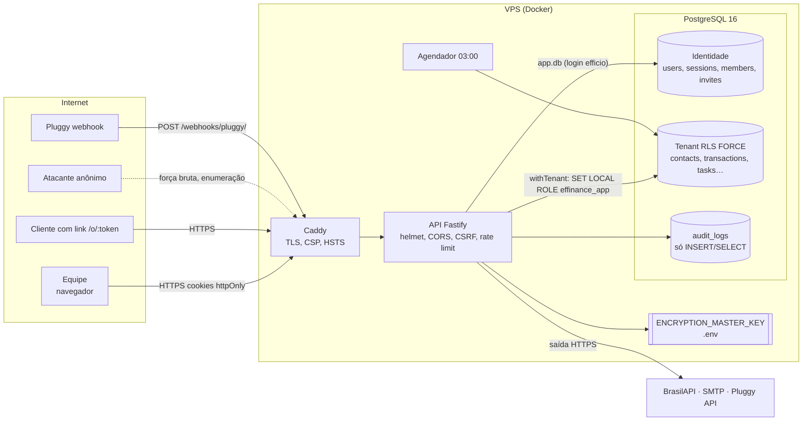
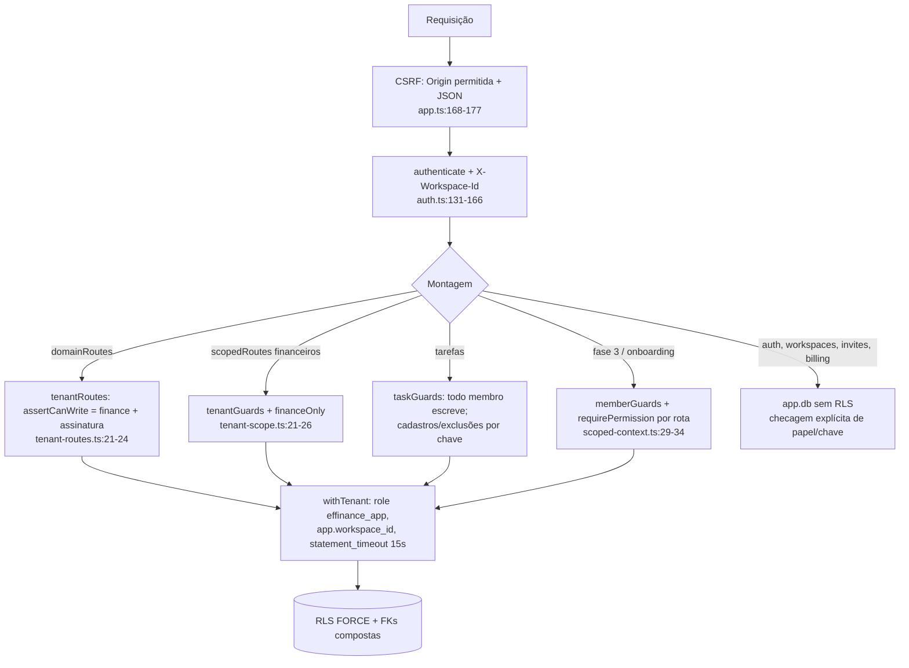
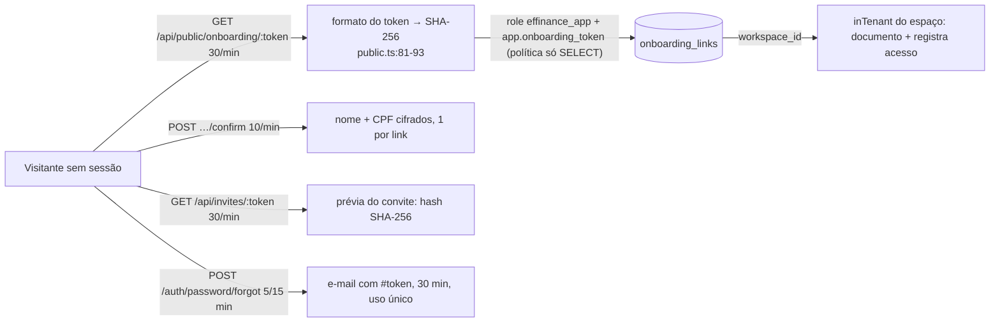
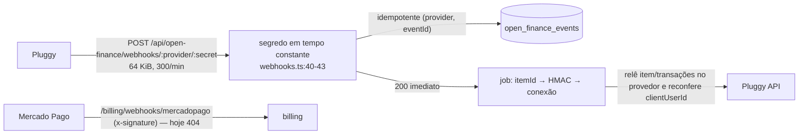
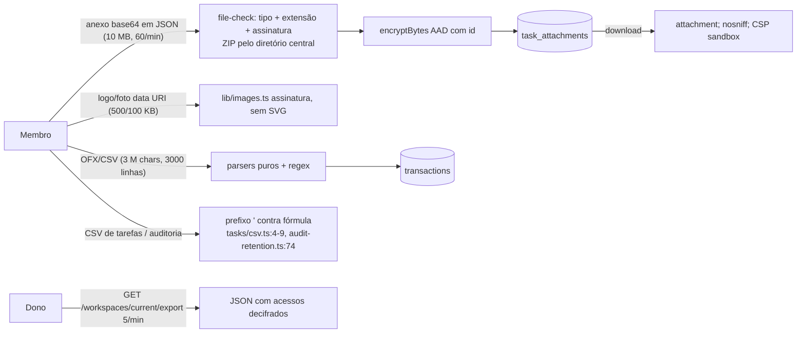

# Modelo de ameaças — Efficio

> Agente `security-threat-model`. Data: 19/11/2026. Base: `CLAUDE.md`, `docs/CODEBASE_MAP.md`,
> `docs/api.md`, `docs/auditoria-2026-11.md` e leitura pontual do código (commit `25af5e1` + alterações
> em andamento de outros agentes). **Só documentação**: nenhuma linha de código foi alterada. As
> referências `arquivo:linha` valem para esse commit; outros agentes estão corrigindo o código em
> paralelo, então confira antes de citar. Itens marcados **(a confirmar)** são hipóteses tiradas da
> documentação ou de leitura parcial e precisam de prova (ver §7).

## 1. Escopo

| Dentro | Fora |
|---|---|
| API Fastify 5 (`apps/api`), PostgreSQL 16 com RLS, cifra por campo e keyring | Hostinger (painel, SSH, firewall), registro.br, GitHub (contas) |
| Web React 19 (`apps/web`), inclusive a página pública `/o/:token` | Segurança física e do sistema operacional do VPS |
| Demo no navegador (PGlite, `vite --mode demo`) | Provedores externos por dentro (Pluggy, BrasilAPI, SMTP, Mercado Pago) |
| Webhooks (Open Finance; Mercado Pago, hoje desligado) | Dispositivos dos funcionários e dos clientes |
| Uploads (anexos, logo, foto), importações OFX/CSV, exportações (JSON LGPD, CSV) | |
| Deploy no VPS (`deploy/`: Caddy, compose, papéis do banco, backup) e cadeia de dependências pnpm | |

**Cenário de produção** (`docs/auditoria-2026-11.md`): um escritório, cerca de 5 usuários internos, um VPS
(Docker Compose: Caddy + API + Postgres), cadastro só por convite (`SIGNUP_ENABLED=false`), 2FA
obrigatória (`REQUIRE_MFA`), cobrança desligada (`BILLING_ENABLED=false`), Open Finance `disabled` por
padrão em produção, chave mestra local (`KEY_PROVIDER=local`). O código continua multi-tenant (vários
espaços por usuário, RLS por `workspace_id`), então o isolamento entre tenants segue no modelo.

## 2. Inventário

### 2.1 Ativos

| # | Ativo | Onde | Classificação |
|---|---|---|---|
| A1 | **Acessos dos clientes** (código do Simples, senha do contador) | `contacts.simples_access_code/accountant_password`, cifrados | Crítico (dá acesso a portais do governo em nome do cliente) |
| A2 | Dados pessoais de clientes e fornecedores (CPF/CNPJ, e-mail, telefone, endereço, responsável, CPF do responsável) | `contacts`, cifrados por campo + índice cego HMAC | Alto (LGPD) |
| A3 | Dados financeiros: honorários, vigências, lançamentos, saldos, inadimplência | `transactions`, `client_fees`, `accounts`… (descrições e nomes **em claro**) | Alto (sigilo comercial) |
| A4 | Anexos de tarefas (documentos fiscais, folha) | `task_attachments.content` bytea cifrado, até 2 GB por espaço | Alto |
| A5 | Credenciais da equipe: hash scrypt, segredo TOTP, códigos de recuperação, refresh tokens | `users`, `sessions` (hash) | Crítico |
| A6 | Segredos da plataforma: `ENCRYPTION_MASTER_KEY`, `JWT_SECRET`, `OPEN_FINANCE_WEBHOOK_SECRET`, `SMTP_PASSWORD`, chaves Pluggy/MP | `.env` do VPS, backups | Crítico (a chave mestra decifra tudo) |
| A7 | Chaves de dados por espaço (embrulhadas) | `workspaces` | Crítico |
| A8 | Tokens de link: onboarding (`/o/:token`), convite, redefinição de senha | só o SHA-256 no banco | Alto |
| A9 | Exportação LGPD (JSON com A1 e A2 **decifrados**) | gerada sob demanda pelo dono | Crítico |
| A10 | Trilha de auditoria (IP, navegador, quem viu acesso) | `audit_logs`, 24 meses | Médio (integridade + dado pessoal) |
| A11 | Confirmações do onboarding (nome e CPF de quem confirmou, IP truncado) | `onboarding_confirmations` cifrado | Médio |
| A12 | Foto do perfil | `user_photos`, chave de plataforma | Baixo |
| A13 | Disponibilidade (rotina diária do escritório, prazos legais) | — | Alto |

### 2.2 Atores

| Ator | Confiança | Como entra |
|---|---|---|
| **Proprietário** (`owner`) | Alta | sessão + 2FA; todas as chaves, exportação, exclusão do espaço |
| **Administrador** (`editor`) | Média-alta | todas as chaves menos `members` |
| **Colaborador** (`viewer`) com chaves ajustadas | Média | páginas + `clients` por padrão; `finance`/`clientCredentials` só se concedidas |
| Ex-membro / membro removido | Nula | sessão antiga, refresh, convite antigo |
| **Cliente do escritório** com link público | Baixa | `/o/:token` (sem sessão) |
| Quem recebeu o link encaminhado (WhatsApp/e-mail) | Nula | o mesmo token |
| **Atacante anônimo** na internet | Nula | rotas públicas, login, webhooks, força bruta |
| **Outro tenant** (membro legítimo de outro espaço) | Nula para os dados deste | sessão válida noutro `workspace_id` |
| Integrações: Pluggy (webhook + API), BrasilAPI (CNPJ), SMTP Hostinger, Mercado Pago (desligado) | Parcial | chamadas de saída; webhook de entrada |
| Operador do VPS / quem tem o grupo `docker` | Total (equivale a root) | SSH |
| Cadeia de suprimentos (npm, imagens Docker, Actions) | Parcial | build e CI |
| Usuário do demo | Nula (dados fictícios, local) | página estática |

### 2.3 Fronteiras de confiança

- **TB1** Internet ↔ Caddy (TLS, HSTS, CSP do web, `deploy/Caddyfile`).
- **TB2** Caddy ↔ API (rede Docker; `trustProxy` de 1 salto, `apps/api/src/app.ts:101`; a API não publica porta, `deploy/docker-compose.prod.yml:11`).
- **TB3** Rotas públicas ↔ autenticadas (`authenticate`, `apps/api/src/lib/auth.ts:131-166`).
- **TB4** Conexão do sistema (`app.db`, tabelas de identidade, sem RLS) ↔ transação de tenant (`effinance_app` + `app.workspace_id`, `apps/api/src/lib/tenant.ts:15-28`).
- **TB5** Membro ↔ chave de permissão (`lib/permissions.ts:48-59`, `lib/finance-access.ts:37`, `modules/workspaces/access.ts:116-137`).
- **TB6** Texto claro ↔ cifra por campo (keyring/KeyProvider, `lib/crypto/*`).
- **TB7** API ↔ provedores externos (saída) e webhooks (entrada).
- **TB8** Navegador do usuário ↔ demo (PGlite em IndexedDB, chave mestra pública).
- **TB9** Build/CI ↔ registro npm e imagens.

## 3. Diagramas de fluxo de dados (DFD)

### 3.1 Visão geral



### 3.2 Autenticação, MFA e sessão

```mermaid
sequenceDiagram
  participant B as Navegador
  participant A as API /auth
  participant DB as users/sessions
  B->>A: POST /auth/login (10/min por IP)
  A->>DB: scrypt verify
  alt conta com 2FA
    A-->>B: MfaChallenge (JWT typ=mfa, 5 min)
    B->>A: POST /auth/mfa/verify (5/min IP; 10 falhas/15 min por conta)
  end
  A->>DB: cria sessão (refresh hash, família)
  A-->>B: effinance_token (JWT 15 min, SameSite=Lax, path /api) + effinance_refresh (30 d, Strict, path /api/auth)
  B->>A: rota de domínio
  A->>DB: loadAccess: membro + sessão viva + mfa_enabled (a cada requisição)
  B->>A: POST /auth/refresh (rotaciona; reuso >10 s revoga a família)
```

Elementos: cookies (`lib/auth.ts:77-90`), JWT HS256 fixo (`lib/auth.ts:117-123`), claims só UUID
(`lib/auth.ts:139`), porta da 2FA obrigatória (`lib/auth.ts:159-161`), `loadAccess`
(`modules/workspaces/access.ts:46-102`), limites (`modules/auth/routes.ts:83-263`), redefinição com token
no fragmento, convite com hash e mesmo e-mail.

### 3.3 Rotas de domínio por workspace



### 3.4 Rotas públicas



Cabeçalhos públicos `no-store`, `noindex`, `no-referrer` em toda resposta (`modules/onboarding/routes.ts:110-114`).

### 3.5 Webhooks



### 3.6 Uploads, importações e exportações



### 3.7 Demo

O demo roda os módulos reais da API no navegador sobre PGlite (`idb://effinance-demo`), com **chave
mestra pública**, sessão no `localStorage`, provedor de pagamento fake e um token de onboarding fixo
(`demoOnboardingToken()`). O build de produção não é o demo (`deploy/web.Dockerfile:24`). Fronteira:
tudo que entra no demo fica no navegador de quem usa; o risco é alguém digitar dado real ou um build de
demo apontar para a API real.

## 4. STRIDE por elemento

| Elemento | S | T | R | I | D | E |
|---|---|---|---|---|---|---|
| Login/MFA | credential stuffing (limite só por IP); cadastro da 2FA por quem souber a senha antes do dono (risco aceito) | — | `auth.login_failed` auditado | enumeração de e-mail por tempo/mensagem (forgot tem tempo mínimo 250 ms) | bloqueio por IP compartilhado | sessão de enrolamento só alcança 3 rotas |
| Sessão/JWT | roubo de cookie via XSS (httpOnly mitiga); Bearer aceito | JWT forjado se `JWT_SECRET` vazar (HS256, sem rotação) | logout/revogação no servidor | token em log (redação de `authorization`/`cookie`, `app.ts:85`) | — | troca de `wid` impossível sem assinar; `loadAccess` reconfere membro |
| CSRF | requisição sem `Origin` passa no filtro de origem (`app.ts:171`); defesa = SameSite + JSON | — | — | — | — | — |
| Rotas de domínio | — | escrita em espaço errado (`409 workspace_mismatch`) | auditoria parcial: baixas/exclusões de lançamentos **sem trilha** (pendência §5 da auditoria) | BOLA entre tenants (RLS + filtro explícito) | consultas pesadas (pageSize 1000, 36 meses, materialização até 5 anos) | BFLA por chave mal aplicada; `page.*` só esconde a UI |
| Conexão do sistema (identidade) | — | alterar membro/sessão/convite de outro espaço se faltar filtro | — | listar membros/sessões de outro espaço | sem `statement_timeout` fora do tenant (a confirmar) | escalada de papel/chave (`assertGrantable`) |
| Onboarding público | quem recebeu o link encaminhado se passa pelo cliente | — | confirmação com qualquer nome/CPF válido (não prova identidade) | documento expõe identidade do escritório, regime, obrigações | 30/min por IP; 1000 acessos/link | política `onboarding_links_public_token` só SELECT |
| Convite | aceitar convite com outro e-mail (bloqueado) | — | auditado | enumeração (corrigida) | 30/h por espaço | papel do convite ≤ quem convida |
| Webhook Open Finance | falsificação se o segredo de caminho vazar (logs de proxy) | payload ignorado (relê do provedor) | evento gravado | — | inundação de syncs (300/min) | — |
| Anexos | — | malware (DOC/XLS com macro, ZIP); sem antivírus | quem anexou fica registrado | download servido com sandbox | 2 GB/espaço, 60/min | — |
| Importação OFX/CSV | — | lançamentos falsos por arquivo adulterado | lote auditado e desfazível | — | ReDoS/CPU nos parsers com 3 M caracteres | — |
| Exportação LGPD | sessão do dono sequestrada exporta tudo | — | `data.exported` | **A1+A2 decifrados num arquivo** | 5/min | — |
| Revelar acesso | — | — | auditado **antes** de revelar | vazamento lento: 10/min por membro | — | conceder `clientCredentials` a quem não deveria |
| Keyring/cifra | — | — | — | chave mestra no `.env` e no backup do VPS: comprometer o VPS = tudo em claro | perder a chave = perder os dados (sem rotação) | — |
| Banco | — | migração como dono; API sem DDL | `audit_logs` sem DELETE para a API | backup contém nomes/valores/descrições em claro (dentro do arquivo cifrado) | — | login da API sem BYPASSRLS, `NOINHERIT` |
| Web | — | — | — | XSS armazenado via texto de contrato/onboarding/descrição (React escapa; sem `dangerouslySetInnerHTML` fora do SDK Pluggy) | — | rotas financeiras dentro do `FinanceGate` (só UI) |
| Infra/supply chain | imagem/pacote adulterado | build comprometido | — | segredos em CI/`.env` | — | grupo `docker` = root; exceção `picomatch` |

## 5. Casos de abuso e LINDDUN

### 5.1 Casos de abuso

| ID | Caso | Caminho do atacante | Controle existente | Lacuna |
|---|---|---|---|---|
| AB1 | **BOLA entre tenants** | membro do espaço B usa ids do espaço A em `/clients/:id`, `/tasks/:id`, `/transactions/:id`, anexos, sindicatos | RLS FORCE + `app.workspace_id` (`tenant.ts:22-25`), FKs compostas, `get*OrThrow` por id + espaço, `test/tasks-scope.test.ts`, `test/phase3-scope.test.ts` | rotas na conexão do sistema (membros, sessões, convites, foto) dependem só do filtro explícito |
| AB2 | **Escalada por chave** | colaborador com `members` concede `finance`/`clientCredentials`; editor rebaixa o dono; ajuste de si mesmo | `assertGrantable`/`resolvePermissionChange`; 422 em si mesmo; dono sem ajuste (CHECK) | `page.*` não é aplicada na API: relatórios/auditoria de tarefas continuam acessíveis por chamada direta |
| AB3 | **BFLA em tarefas** | `viewer` escreve em tarefas (por projeto); tenta rotas de cadastro/exclusão | `requireTaskPermission`, `test/tasks-security.test.ts` | anotações pessoais isoladas só por filtro de usuário (RLS é por espaço) |
| AB4 | **Enumeração de tokens** | força bruta em `/o/:token`, `/invites/:token`, reset | 32 bytes aleatórios (onboarding), hash SHA-256, limites por IP, 404 genérico | links de onboarding valem até 90 dias e reenviar **não revoga** os anteriores; token fixo e público no demo |
| AB5 | **CSV/fórmula injection** | descrição de tarefa ou nome iniciando com `=HYPERLINK(...)` exportado | prefixo `'` em `tasks/csv.ts:9` e `audit-retention.ts:74` | exportações montadas no web (relatórios de tarefas, `features/workspaces/api.ts`) e cartas/relatórios impressos (a confirmar) |
| AB6 | **SSRF em consulta externa** | CNPJ manipulado para atingir host interno | host fixo `https://brasilapi.com.br` (`brasilapi.ts:10`), CNPJ validado 14 dígitos, timeout 10 s (`:147`), 30/min | nenhuma relevante; Pluggy usa host fixo; e-mail usa `APP_URL` do env |
| AB7 | **ReDoS** | OFX/CSV com 3 M caracteres e padrões patológicos; campos de busca | limites de tamanho, `max(80/200)` em buscas | regex dos parsers de valores/datas não auditadas para backtracking (a confirmar) |
| AB8 | **DoS por consulta pesada** | `pageSize=1000`, `months=36`, séries sem fim, dashboard, busca global em loop | `statement_timeout` 15 s no tenant, limites de schema | `@fastify/rate-limit` com `global: false` (`app.ts:163`): rotas sem `config` não têm limite; consultas na conexão do sistema sem timeout |
| AB9 | **Supply chain** | pacote npm malicioso, imagem base adulterada, Action comprometida | lockfile, `pnpm audit` no CI, SDK Pluggy empacotado (sem CDN) | SBOM/assinatura de imagem ausentes; exceção `picomatch` |
| AB10 | **Sequestro da conta do dono** | phishing + roubo de sessão → exportação LGPD, exclusão do espaço | 2FA obrigatória, sessões revogáveis, auditoria | exportação e `DELETE /workspaces/current` (só digita o nome, `saas.ts:392`) **sem reautenticação/step-up**; excluir apaga a chave (crypto-shredding) |
| AB11 | **Exfiltração lenta de acessos** | membro com `clientCredentials` revela 10/min | auditoria antes do valor, "quem viu" | sem alerta ativo; 600 revelações/hora passam |
| AB12 | **Malware em anexo** | membro (ou conta comprometida) sobe DOC/XLS com macro | assinatura, sem HTML/SVG, download `attachment` + sandbox | sem antivírus; OLE2 permitido |
| AB13 | **Falsificação de webhook** | segredo do caminho vazado em log do Caddy/proxy | comparação constante, idempotência, rereleitura no provedor | segredo no caminho aparece em logs de acesso (a confirmar no Caddyfile) |
| AB14 | **Link de onboarding encaminhado** | cliente encaminha o link; terceiro confirma com CPF qualquer | 404 genérico, expiração, revogação, IP truncado | confirmação não autentica o titular (valor probatório fraco) |
| AB15 | **Demo com dado real** | usuário digita dados reais no demo público | build de produção não é demo | demo usa chave pública: dados no IndexedDB são legíveis por qualquer script da origem |

### 5.2 LINDDUN (privacidade)

| Ameaça | Onde | Situação |
|---|---|---|
| **L**inkability | índices cegos HMAC (CPF/CNPJ, nome do responsável) por espaço; IP truncado + aparelho no onboarding | aceitável; HMAC com chave por espaço evita ligar entre tenants (a confirmar a chave usada) |
| **I**dentifiability | nomes, títulos de tarefas e descrições de lançamentos em claro | decisão de produto (busca); backups carregam isso em claro |
| **N**on-repudiation (excesso) | `audit_logs` com IP e navegador por 24 meses | retenção definida, aviso e expurgo |
| **D**etectability | 404 igual para link inválido/expirado/revogado; forgot sempre 204 | ok |
| **D**isclosure | exportação LGPD com acessos decifrados; JSON baixado no computador do dono | maior risco de divulgação do sistema |
| **U**nawareness | cliente não sabe que o acesso ao link é registrado (aparelho, IP truncado) | revisar aviso na página pública e na política (com `security-privacy-lgpd`) |
| **N**on-compliance | direitos do titular para **clientes do escritório** (não usuários): sem fluxo próprio de acesso/eliminação por titular | encaminhar ao agente LGPD |

## 6. Tabela de ameaças priorizada

Risco = Probabilidade (1–5) × Impacto (1–5). Crítico ≥ 15, Alto 10–14, Médio 5–9, Baixo ≤ 4.

| # | Ameaça | P | I | Risco | Controle existente | Lacuna principal |
|---|---|---|---|---|---|---|
| T1 | Comprometimento do VPS/`.env` (chave mestra, `JWT_SECRET`) → todos os dados decifrados e tokens forjados | 2 | 5 | **10 Alto** | API sem porta exposta, papéis do banco separados, `env.ts:212-249` recusa segredos fracos | chave mestra local sem rotação no mesmo host; grupo `docker` = root; backup com chave |
| T2 | Sequestro da sessão/conta do dono → exportação LGPD (A1+A2) ou exclusão do espaço | 2 | 5 | **10 Alto** | 2FA obrigatória, `loadAccess` por requisição, auditoria | sem step-up (senha/TOTP) na exportação e na exclusão do espaço |
| T3 | BOLA/IDOR nas rotas de identidade (membros, sessões, convites, foto, permissões) que rodam sem RLS | 2 | 5 | **10 Alto** | filtros explícitos, `test/db-roles.ts`, foto restrita a membros do espaço | só o filtro da aplicação protege; testar cada `:userId`/`:id` |
| T4 | Escalada de permissão por chave (BFLA) e `page.*` não aplicadas na API | 3 | 4 | **12 Alto** | `assertGrantable`, guardas por rota, `test/finance-access.test.ts` | dono espera que desligar `page.reports`/`page.audit` bloqueie; API não bloqueia |
| T5 | Exfiltração de acessos dos clientes por membro com `clientCredentials` | 2 | 5 | **10 Alto** | 10/min por membro, auditoria antes, "quem viu" | sem alerta/limite diário; padrão só administradores |
| T6 | BOLA entre tenants nas rotas de domínio | 1 | 5 | 5 Médio | RLS FORCE, FKs compostas, testes de escopo | regressão em módulo novo; manter os testes de catálogo |
| T7 | Credential stuffing / força bruta no login | 3 | 3 | 9 Médio | 10/min por IP, 2FA, scrypt | sem limite por conta; enrolamento da 2FA por quem tem a senha (aceito) |
| T8 | Link público de onboarding vazado/encaminhado (vários links ativos, até 90 dias) | 3 | 2 | 6 Médio | 256 bits, hash, 404 genérico, revogação, `no-referrer` | reenviar não revoga anteriores; confirmação sem prova de identidade |
| T9 | DoS autenticado/anônimo (rotas sem rate limit, consultas pesadas, anexos base64 em memória) | 3 | 3 | 9 Médio | `statement_timeout` 15 s, limites de schema, 2 GB/espaço | `global: false`; uma instância só; parsers e cifra em memória |
| T10 | Malware em anexo baixado pela equipe | 2 | 4 | 8 Médio | assinatura, lista de tipos, download isolado | sem antivírus; macros em OLE2 |
| T11 | CSRF residual (sem `Origin`, GET com efeito) | 1 | 4 | 4 Baixo | SameSite Lax/Strict, JSON obrigatório, origem permitida | requisição sem `Origin` passa no filtro; confirmar que nenhum GET muda estado (o GET público registra acesso, sem sessão) |
| T12 | CSV/fórmula injection em exportações do web | 2 | 3 | 6 Médio | servidor sanitiza CSV de tarefas e auditoria | exportações geradas no navegador (a confirmar) |
| T13 | ReDoS nos parsers OFX/CSV | 2 | 3 | 6 Médio | limites de tamanho e linhas, 30 prévias/min | revisão das regex |
| T14 | Webhook Open Finance falsificado / segredo em log | 1 | 2 | 2 Baixo | tempo constante, idempotência, relê do provedor; desligado em produção | segredo em URL |
| T15 | XSS armazenado (contrato, onboarding, descrições) → ações na sessão | 1 | 5 | 5 Médio | React escapa, CSP com hashes, sem `dangerouslySetInnerHTML` | impressão/PDF e cartas (`lib/print.ts`) a revisar |
| T16 | Repúdio de ações financeiras (baixa/exclusão de lançamento sem trilha) | 3 | 3 | 9 Médio | auditoria de segurança | trilha financeira pendente (`auditoria-2026-11.md` §5) |
| T17 | Supply chain (npm, imagens, CI) | 2 | 4 | 8 Médio | lockfile, `pnpm audit`, CI | sem SBOM, sem pin por digest/assinatura (com `security-infra-supply-chain`) |
| T18 | Perda da chave mestra / exclusão do dono apaga tudo | 2 | 5 | **10 Alto** | backup diário, cópia offline obrigatória (procedimento) | depende de processo manual; testar restauração |
| T19 | Demo exposto com dado real ou apontando para API real | 1 | 2 | 2 Baixo | build separado, chave e token públicos só no demo | aviso visível no demo |

## 7. Plano de testes de invasão

Executar em ambiente local (`security-pentest-dast`), com dois espaços (A e B) e quatro contas: dono A,
editor A, colaborador A (sem `finance`), dono B. Registrar prova (requisição/resposta) e abrir correção
com teste de regressão no agente da camada.

### 7.1 Prioritários (ameaças altas)

| Ameaça | Teste | Resultado esperado |
|---|---|---|
| T3, T6 | Com a sessão do dono B, chamar `PATCH/DELETE /workspaces/current/members/:userId`, `GET/PUT …/permissions`, `DELETE /auth/sessions/:id`, `DELETE …/invites/:id`, `GET /profile/photos/:userId` usando ids do espaço A | 404 em todas; nada muda em A |
| T6 | Varredura automática: para cada rota com `:id` (clientes, lançamentos, anexos, documentos, sindicatos, links de onboarding, lotes de importação, conexões), trocar o id por um do espaço B; também em corpos (`clientIds`, `categoryId`, `accountId`, `replacementId`) | 404/422; nenhuma linha cruzada |
| T4 | Colaborador A sem `finance`: todas as rotas de `FINANCE_MODULES` + `/clients/:id/fees`, `/clients/:id/contract`, `PUT /clients/:id`; desligar `page.reports`/`page.audit` e chamar `GET /tasks/reports*`, `/tasks/audit*`, exportação CSV | 403 no financeiro; registrar como achado se `page.*` passar |
| T4 | Editor A (sem `members`) tenta `PUT …/permissions` para dar `members`; colaborador com `members` tenta conceder `finance` ou `clientCredentials`; ajustar a si mesmo; rebaixar o dono; convite com papel `owner` | 403/422 |
| T2 | Com cookie roubado do dono (sem saber a senha/TOTP): `GET /workspaces/current/export`, `DELETE /workspaces/current`, `POST /auth/mfa/disable`, `POST /auth/password` | Documentar o que passa sem step-up (esperado hoje: exportação e exclusão passam) |
| T5 | Revelar acessos em laço (11/min, por vários IPs com o mesmo membro); conferir `audit_logs` antes da resposta; tentar com colaborador sem a chave e com `field` inválido | 429 no 11º; 403 sem chave; auditoria sempre gravada |
| T1, T18 | Revisão de configuração: `.env` (permissões 600, dono), `docker inspect` (portas, usuário não root), `grants-api.sql` aplicado, backup cifrado não contém a chave mestra; restauração num host limpo | conforme `deploy-hostinger.md` |
| T7 | 50 tentativas de login distribuídas em 5 IPs (via `X-Forwarded-For` com e sem Caddy) contra a mesma conta; MFA com 11 códigos errados | `X-Forwarded-For` forjado ignorado atrás de 1 salto; 429 por conta na 2FA |

### 7.2 Complementares

| Ameaça | Teste |
|---|---|
| T8 | Força bruta em `/api/public/onboarding/:token` (formato válido e inválido) medindo tempo e corpo; link expirado/revogado/de outro espaço → 404 idêntico; dois links ativos do mesmo cliente após "reenviar"; segunda confirmação → 409; cabeçalhos em 404/429 |
| T9 | `GET /tasks/reports?pageSize=1000`, `/reports/evolution?months=36`, `/dashboard` com séries até 5 anos, busca global em rajada; anexo de 10 MB × 60/min; medir CPU/memória e confirmar `statement_timeout`; listar rotas sem `config.rateLimit` |
| T10 | Upload de PDF com HTML, DOCX sem `word/`, ZIP64, zip-bomb pelo diretório central, nome com `../`, bidi e `"`; download conferindo `Content-Disposition`, `nosniff`, CSP sandbox |
| T11 | `POST` cross-site com `text/plain`, com `Origin: https://evil`, sem `Origin`; `fetch` com `credentials: include` de outra origem (CORS); listar GETs que gravam algo |
| T12 | Cadastrar cliente/tarefa com `=HYPERLINK("http://x")`, `+cmd`, `@SUM`, `\t=` e exportar todos os CSV (servidor e web) |
| T13 | OFX/CSV de 3 M caracteres com valores `1,1,1,…`, datas malformadas e aspas desbalanceadas; medir tempo da prévia |
| T14 | Webhook com segredo errado (tempo), `:provider` diferente, `eventId` repetido, corpo de 64 KiB+, `itemId` de outro espaço; verificar se o caminho com segredo aparece em logs do Caddy/API |
| T15 | Injetar ``, `javascript:` e marcadores `{{…}}` em modelo de contrato, onboarding, nome de cliente, descrição; abrir ficha, contrato impresso, cartas de reajuste e `/o/:token`; conferir CSP no cabeçalho do Caddy |
| T16 | Dar baixa e excluir lançamento e conferir o que fica em `audit_logs` |
| T17 | `pnpm audit`, osv-scanner, gitleaks no histórico, revisão das Actions (pin por SHA) — com `security-sast-sca` |
| Sessão | Refresh reapresentado após 10 s revoga a família; membro removido perde acesso na próxima requisição; `X-Workspace-Id` divergente em escrita → 409; JWT com `alg: none`/RS256 → 401; claims não UUID → 401 |

## 8. Controles existentes (resumo com referências)

- Cabeçalhos e CSP da API: `apps/api/src/app.ts:149-156`; `no-store`: `:159-162`; CORS com credenciais: `:157`.
- CSRF (origem + JSON): `apps/api/src/app.ts:168-177`; parser JSON padrão (anti `__proto__`): `:109-114`.
- Logs sem segredo: `apps/api/src/app.ts:85-86` + `lib/log.ts`.
- Sessão/JWT/2FA: `apps/api/src/lib/auth.ts:77-90`, `:117-123`, `:139`, `:144-153`, `:159-161`; `modules/workspaces/access.ts:46-102`.
- Limites de autenticação: `apps/api/src/modules/auth/routes.ts:64`, `:83`, `:98`, `:107`, `:122`, `:173`, `:199`.
- Fronteira de tenant: `lib/tenant.ts:15-28`, `lib/tenant-routes.ts:21-38`, `lib/tenant-scope.ts:21-41`, `lib/scoped-context.ts:29-37`.
- Permissões: `lib/permissions.ts:48-59`, `lib/finance-access.ts:37`, `modules/workspaces/access.ts:116-137`; CNPJ por chaves: `modules/clients/routes.ts:132-134`.
- Revelar acesso: `modules/client-records/routes.ts:58-62`.
- Onboarding público: `modules/onboarding/public.ts:81-93`, `modules/onboarding/routes.ts:110-126`.
- Webhook: `modules/open-finance/routes.ts:103-117`, `modules/open-finance/webhooks.ts:40-43`; Mercado Pago: `modules/billing/routes.ts:32` (404 desligado).
- Exportação e auditoria: `modules/workspaces/routes.ts:185-190`, `:208-215`; convites `:232-238`.
- CSV seguro: `modules/tasks/csv.ts:4-9`, `modules/workspaces/audit-retention.ts:71-74`.
- Foto: `modules/profile/routes.ts:27-36`; anexos: `modules/tasks/routes.ts:406-408` + `file-check.ts`.
- Validação de ambiente: `apps/api/src/env.ts:74`, `:204-205`, `:212-213`, `:243-249`; `REQUIRE_MFA`/`SIGNUP_ENABLED` padrão de produção: `:262-273`.
- CNPJ: `modules/clients/providers/brasilapi.ts:10`, `:147`.

## 9. Lacunas consolidadas (para os agentes de correção)

1. **Step-up** (senha ou TOTP recente) na exportação LGPD, na exclusão do espaço e na revelação de acessos — `security-node-api`.
2. **Aplicar `page.*` na API** ou documentar claramente na tela que são só de navegação — `security-authz-tenancy`.
3. **Rate limit padrão** (global com teto alto) e `statement_timeout` também na conexão do sistema — `security-node-api`.
4. **Reenviar link de onboarding** com opção de revogar os anteriores; validade padrão menor — produto + `security-node-api`.
5. **Alerta** de revelações em volume (ex.: > 20/dia por membro) e de exportações — `security-node-api`.
6. **Trilha financeira** (baixa, estorno, exclusão de lançamento) — `backend-senior`.
7. Revisar **regex dos parsers** OFX/CSV e exportações CSV geradas no web — `security-sast-sca`/`security-react-web`.
8. **Antivírus** ou bloqueio de macros (OLE2) nos anexos — decisão do dono.
9. Chave mestra: cópia offline testada, avaliar KMS/rotação; tirar o usuário do grupo `docker` — `security-infra-supply-chain`.
10. Conferir que o segredo do webhook e tokens não aparecem em logs do Caddy — `security-infra-supply-chain`.
11. Direitos do titular (clientes do escritório) e aviso de registro de acesso no `/o/:token` — `security-privacy-lgpd`.

## 10. Manutenção deste modelo

Revisar a cada módulo novo com rota pública, upload, integração externa, chave de permissão nova ou
mudança de deploy. Atualizar a tabela §6 com o resultado dos testes do §7 (achado confirmado → risco
recalculado e referência do teste de regressão).
